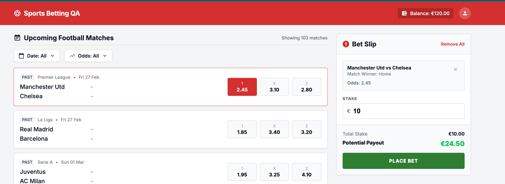
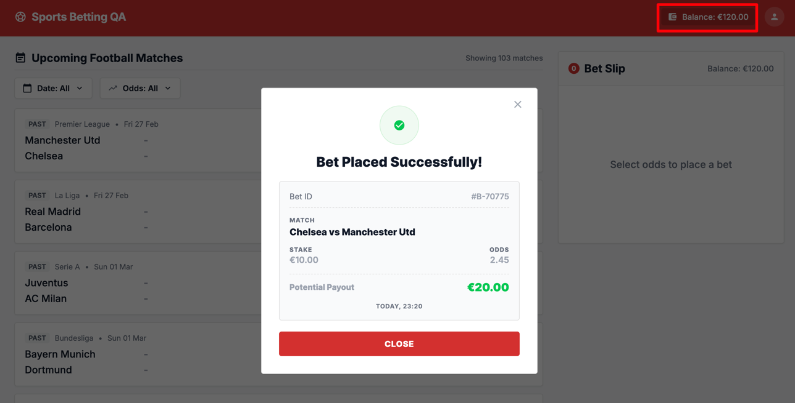

#### ID: BUG-006
#### Title: Balance in UI is not updated after bet placement until page refresh
#### Severity: Medium
#### Test case: [1 - Successful bet placement](../Test%20plan/1-place-bet.md)
#### Preconditions: User is logged in, balance €120.00
#### Steps to reproduce
1. Open main page, note Balance in header (€120.00).
2. Click odds 1 (2.45) for Manchester Utd vs Chelsea.
3. Enter stake €10 in Bet Slip.
4. Click PLACE BET.
5. Check Balance in header and in Bet Slip.
6. Refresh page and check Balance again.
#### Expected result:
After "Bet Placed Successfully!" Balance in header and Bet Slip is updated to €110.00 without page refresh.
#### Actual result:
- Bet is placed (Bet ID #B-70775), but header and Bet Slip still show Balance €120.00.
- Updated balance is shown only after page refresh.
#### Business Impact: User sees wrong available funds → may place bets assuming money they no longer have, gets unexpected rejections or loses trust in wallet accuracy.
#### Evidence:

