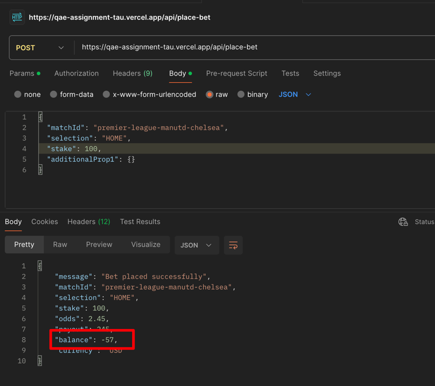

#### ID: BUG-005
#### Title: place-bet API accepts stake greater than user balance, balance goes negative
#### Severity: Critical
#### Test case: [6 - POST /api/place-bet rejects invalid requests](../Test%20plan/6-place-bet-via-api.md) (row 20), [3 - Stake exceeding available balance is rejected](../Test%20plan/3-max-bet.md)
#### Preconditions: User balance less than 100 Euro (check via `balance` endpoint or UI)
#### Steps to reproduce
1. Send `POST https://qae-assignment-tau.vercel.app/api/place-bet` with same params/headers as UI request and body:
```json
{
  "matchId": "premier-league-manutd-chelsea",
  "selection": "HOME",
  "stake": 100
}
```
2. Check response status and `balance`.
#### Expected result:
Request is rejected (e.g. 400/422 "Insufficient balance"), bet is not created, balance stays €43.
#### Actual result:
Bet is accepted, balance becomes negative:
```json
{
  "message": "Bet placed successfully",
  "matchId": "premier-league-manutd-chelsea",
  "selection": "HOME",
  "stake": 100,
  "odds": 2.45,
  "payout": 245,
  "balance": -57,
  "currency": "USD"
}
```
#### Business Impact: Users can bet money they don't have (unlimited credit) → direct financial loss on winning bets, unrecoverable debt and regulatory breach.
#### Evidence:

