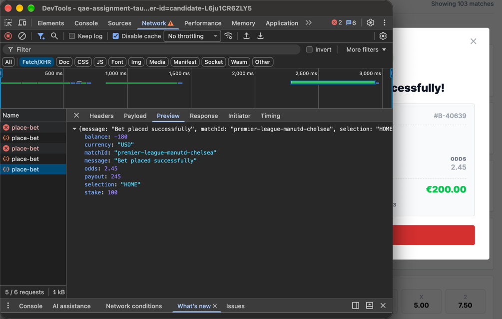

#### ID: BUG-007
#### Title: Repeated clicks on Place bet create multiple bets, balance goes negative
#### Severity: Critical
#### Test case: [4 - Duplicate submission does not create two bets](../Test%20plan/4-duplicate-submission.md), [6 - POST /api/place-bet rejects invalid requests](../Test%20plan/6-place-bet-via-api.md) (row 19)
#### Preconditions: User is logged in, balance less than 3 × stake (e.g. €120)
#### Steps to reproduce
1. Open main page, open DevTools → Network → Fetch/XHR.
2. Click odds 1 (2.45) for Manchester Utd vs Chelsea.
3. Enter stake €100 in Bet Slip.
4. Click Place bet several times quickly (5 clicks) without waiting for response.
5. Check `place-bet` requests and `balance` in last response.
#### Expected result:
- Place bet is disabled after first click until response arrives.
- Only one `place-bet` request is sent, only one bet is created.
- Backend rejects duplicate submission (e.g. idempotency key) and any bet exceeding balance.
#### Actual result:
- 5 `place-bet` requests are sent: 3 succeed, 2 fail.
- Only one "Bet Placed Successfully!" modal is shown, but several bets are created.
- Last response: `"stake": 100`, `"balance": -180`.
#### Business Impact: User is charged for bets they did not intend to place and balance goes negative → financial loss, chargebacks, disputes and loss of trust.
#### Evidence:

