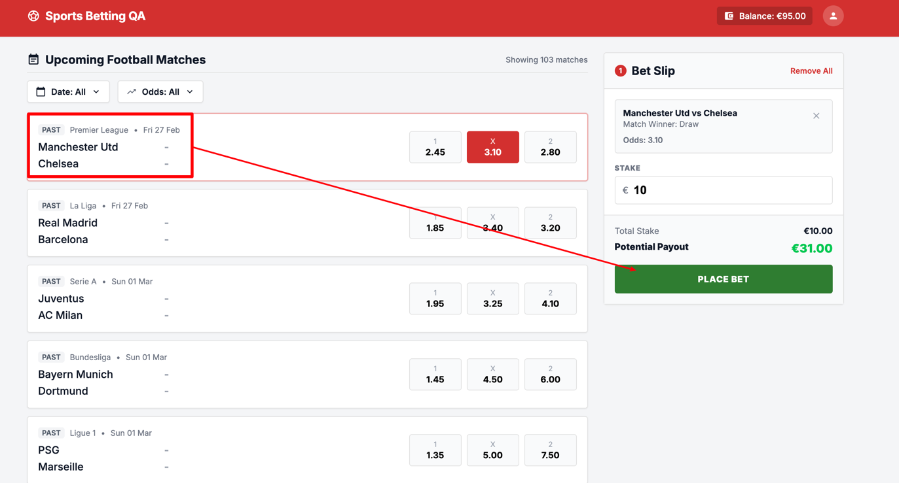
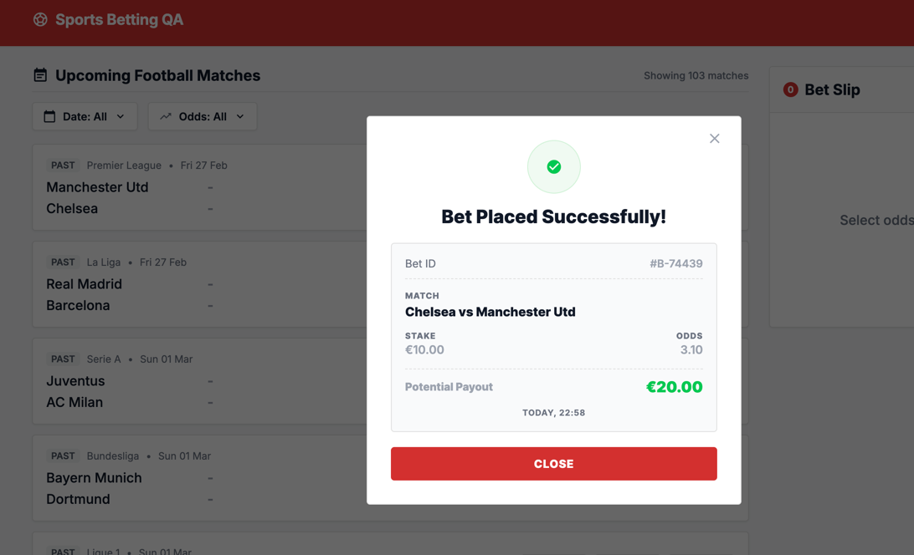

#### ID: BUG-001
#### Title: Past events are shown in "Upcoming" match list and accept bets
#### Severity: Critical
#### Test case: [1 - Successful bet placement](../Test%20plan/1-place-bet.md)
#### Preconditions: User is logged in, balance ≥ €10
#### Steps to reproduce
1. Open main page.
2. Look at "Upcoming Football Matches" list (Date: All).
3. Find event tagged PAST (e.g. Manchester Utd vs Chelsea, Fri 27 Feb).
4. Click odds X (3.10).
5. Enter stake €10 in Bet Slip.
6. Click PLACE BET.
#### Expected result:
- Only upcoming (not started) events are displayed in "Upcoming Football Matches".
- Odds for past events are not selectable; bet on started/finished event is rejected.
#### Actual result:
- Past events are displayed in "Upcoming Football Matches" list.
- Odds are selectable and bet is accepted: "Bet Placed Successfully!", Bet ID #B-74439.
#### Business Impact: Users can bet on matches with known outcomes (past-posting) → guaranteed wins, direct financial loss, fraud exposure and regulatory risk.
#### Evidence:

