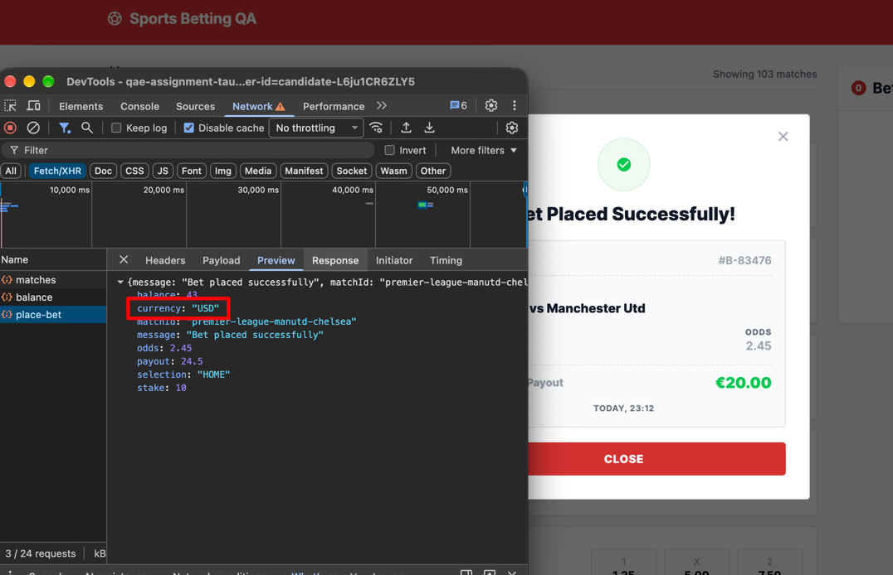

#### ID: BUG-004
#### Title: place-bet API response returns currency "USD" instead of "EUR"
#### Severity: High
#### Preconditions: User is logged in, balance ≥ €10, account currency is EUR (UI shows €)
#### Steps to reproduce
1. Open main page, open DevTools → Network → Fetch/XHR.
2. In "Upcoming Football Matches" list click odds 1 (2.45) for Manchester Utd vs Chelsea.
3. Enter stake €10 in Bet Slip.
4. Click PLACE BET.
5. Open `place-bet` request → Response.
#### Expected result:
Response has `"currency": "EUR"`, matching account currency and UI (€).
#### Actual result:
Response (Bet ID #B-83476) has `"currency": "USD"`:
```json
{
  "message": "Bet placed successfully",
  "matchId": "premier-league-manutd-chelsea",
  "selection": "HOME",
  "odds": 2.45,
  "stake": 10,
  "payout": 24.5,
  "balance": 43,
  "currency": "USD"
}
```
#### Business Impact: Bet is recorded in wrong currency → wrong settlement, wallet balance or conversion, and incorrect financial/regulatory reporting for EUR accounts.
#### Evidence:

