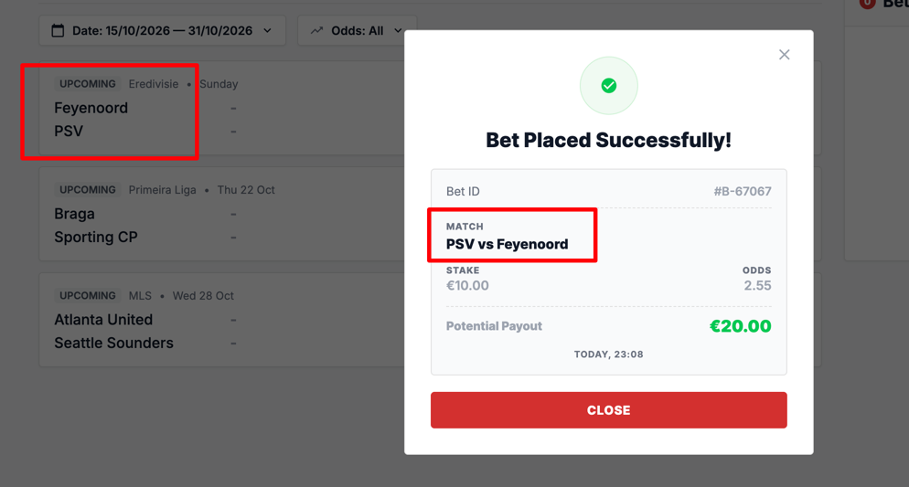

#### ID: BUG-003
#### Title: Home and away teams are swapped in bet confirmation
#### Severity: Medium
#### Test case: [1 - Successful bet placement](../Test%20plan/1-place-bet.md)
#### Preconditions: User is logged in, balance ≥ €10
#### Steps to reproduce
1. Open main page.
2. In "Upcoming Football Matches" list click odds 1 (2.55) for Feyenoord vs PSV.
3. Check match name in Bet Slip.
4. Enter stake €10 and click Place bet.
5. Check match name in "Bet Placed Successfully!" dialog.
#### Expected result:
Confirmation shows match as "Feyenoord vs PSV", same order as match list and Bet Slip.
#### Actual result:
Confirmation (Bet ID #B-67067) shows "PSV vs Feyenoord".
#### Business Impact: For 1/2 (home/away) bets user cannot be sure which team they backed → confusion, support tickets and disputes.
#### Evidence:

