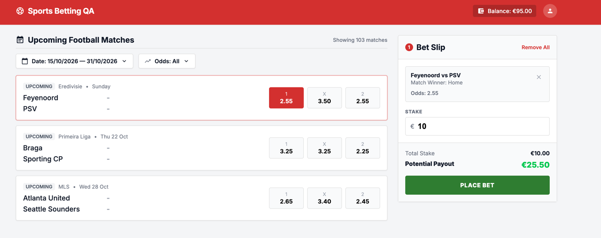
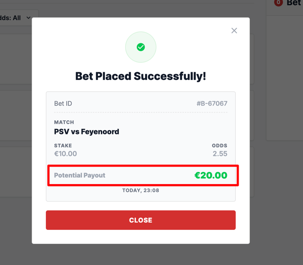

#### ID: BUG-002
#### Title: Potential payout in bet confirmation does not match stake × odds
#### Severity: High
#### Test case: [1 - Successful bet placement](../Test%20plan/1-place-bet.md)
#### Preconditions: User is logged in, balance ≥ €10
#### Steps to reproduce
1. Open main page.
2. In "Upcoming Football Matches" list click odds 1 (2.55) for Feyenoord vs PSV.
3. Enter stake €10 in Bet Slip.
4. Check Potential Payout in Bet Slip.
5. Click Place bet.
6. Check Potential Payout in "Bet Placed Successfully!" dialog.
#### Expected result:
Potential Payout in confirmation = stake × odds = €10 × 2.55 = €25.50, same as in Bet Slip.
#### Actual result:
- Bet Slip shows Potential Payout €25.50.
- Confirmation (Bet ID #B-67067) shows stake €10.00, odds 2.55, Potential Payout €20.00.
#### Business Impact: User sees a different payout than agreed in Bet Slip → loss of trust, customer disputes and risk of wrong settlement if €20.00 is the stored value.
#### Evidence:

